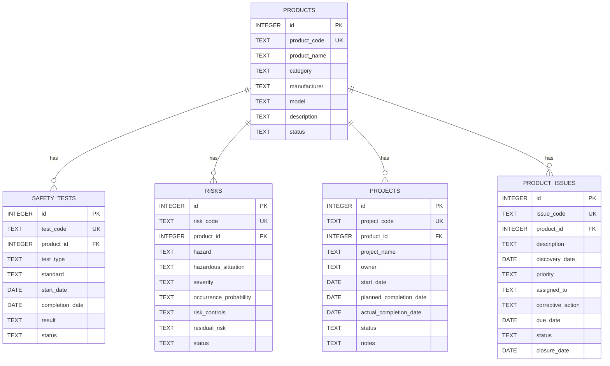

# MedTech Compliance Hub
## Entity Relationship Diagram (ERD)

### 1. Overview

The database uses a relational data model to manage fictional medical device products and their associated compliance activities.

The initial database contains five entities:

1. Products
2. SafetyTests
3. Risks
4. Projects
5. ProductIssues

Each entity has a primary key. Related records reference Products through a foreign key.

All data is fictional and intended for portfolio demonstration.

### 2. Entity Relationships

### 3. Entity Descriptions

#### 3.1 Products

Stores the basic information of each fictional medical device.

- Primary key: `id`
- Unique product identifier: `product_code`
- Contains product name, category, manufacturer, model, description, and status.

#### 3.2 SafetyTests

Stores safety testing activities and their results.

- Primary key: `id`
- Unique test identifier: `test_code`
- Foreign key: `product_id`
- Records test type, applicable standard, testing dates, result, and status.

#### 3.3 Risks

Stores identified hazards and risk management information.

- Primary key: `id`
- Unique risk identifier: `risk_code`
- Foreign key: `product_id`
- Records hazard descriptions, hazardous situations, severity, occurrence information, risk controls, residual risk, and review status.

#### 3.4 Projects

Stores compliance project information.

- Primary key: `id`
- Unique project identifier: `project_code`
- Foreign key: `product_id`
- Records project name, owner, planned dates, actual completion date, status, and notes.

#### 3.5 ProductIssues

Stores product issues and their follow-up activities.

- Primary key: `id`
- Unique issue identifier: `issue_code`
- Foreign key: `product_id`
- Records issue descriptions, priority, assigned personnel, corrective actions, deadlines, status, and closure dates.

### 4. Relationship Rules

- One product can have zero or many safety testing records.
- One product can have zero or many risk records.
- One product can have zero or many compliance projects.
- One product can have zero or many product issue records.
- Each safety testing, risk, project, and product issue record belongs to one product.
- Each foreign key must reference an existing product.

### 5. Key Design

#### Primary Keys

Each table uses an integer primary key named `id`.

The primary key uniquely identifies a database record.

#### Business Identifiers

Each record also has a human-readable identifier, such as:

- Product: `MD-004`
- Safety test: `TEST-004`
- Risk: `RISK-004`
- Project: `PROJ-004`
- Product issue: `ISSUE-004`

These identifiers are intended for display and record tracking.

#### Foreign Keys

The `product_id` field in each related table references `Products.id`.

This design avoids using product code text as the database relationship key and helps maintain referential integrity.

### 6. Data Integrity Rules

- Product codes and other business identifiers must be unique.
- Required fields must not be empty.
- Foreign keys must reference existing product records.
- Dates must use a consistent format, such as `YYYY-MM-DD`.
- Status and priority values should follow a consistent set of allowed values.
- Test results and workflow statuses must be stored separately.

### 7. Scope and Limitations

This ERD represents the initial version of the demonstration database.
